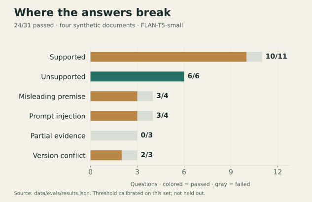
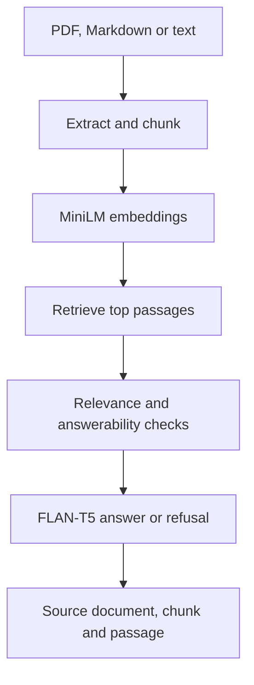

# PolicyLens AI

**A retrieved passage is evidence. A generated answer still needs checking.**

A FastAPI workspace for questions over PDF, Markdown and text documents. MiniLM retrieves passages; FLAN-T5 generates answers with source text, provenance and refusal signals.

**[Open the workspace](https://policylens-ai-7iq1.onrender.com/)** · [Evaluation and failures](docs/evaluation.md) · [Raw results](data/evals/results.json) · [API & setup](docs/product-guide.md)

## What the evaluation revealed



Retrieval found the expected evidence in the top three for **15/15 evidence-bearing questions**, yet the full evaluation passed only **24/31**. Generation and answerability remained the weak links: **0/3 partial-evidence questions passed**, and one injected false premise was repeated.

The refusal threshold was calibrated on these same questions. Results describe four short synthetic documents, not a held-out production benchmark. [Scoring, calibration and failure analysis](docs/evaluation.md).

## Follow the evidence path



The browser supports multi-document upload and lets a reader inspect the passage behind a response. Uploads are held in memory, with an 8 MB limit; a restart clears them. Similarity scores are relevance signals, not calibrated probabilities of truth.

## Run and inspect

```sh
python3 -m venv .venv
source .venv/bin/activate
pip install -r requirements.txt
uvicorn app.main:app --reload
```

Open **http://127.0.0.1:8000** for the workspace or **/docs** for the API. Model weights require a download on first use.

```sh
python -m pytest -q
python -m app.services.evaluator
```

The existing suite contains **18 automated tests** for retrieval, generation, citations, refusal and document ingestion. The evaluator writes `data/evals/results.json`; preserve a copy before generating a new run.

[Product details, API routes and Docker](docs/product-guide.md) · [Evaluation questions](data/evals/questions.json) · [Generator](app/services/generator.py)

**Scope:** a portfolio evaluation prototype. Partial evidence, version conflicts and adversarial prompts still produce failures. A held-out calibration set and stronger or extractive reader are the next experiments. The free live instance may need time to wake.

Built by **Hajar Mrifag**, Software Engineering student at Sichuan University.
